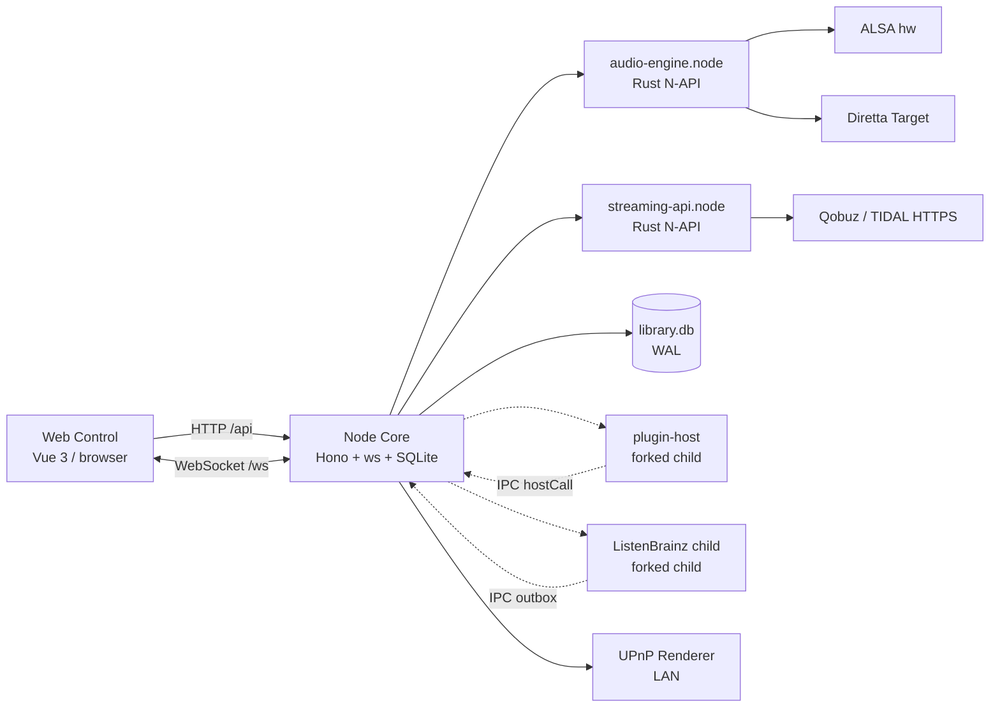

# SPlayer Atom Project Book

> Last updated: 2026-10-26
>
> Code baseline: `dev` branch commit `5693b3fc`, product version `1.1.3`
>
> Document type: project charter and current-state description for project owners, architecture reviewers, and acceptance teams

## 1. Summary

SPlayer Atom is a music player for Linux x86-64 hosts. It centralizes music-domain state, playback control, source resolution, caching, and persistence in a long-running **Node Core** process, while the browser provides only the **Web Control** interface. Any computer, tablet, or phone on the LAN can open the same address and control playback. Closing the page does not interrupt playback in the Core, and every device sees the same queue, position, login state, and output selection.

The project is based on [SPlayer-Next](https://github.com/SPlayer-Dev/SPlayer-Next) and reuses its music data model and much of its interface capability, but changes the runtime shape from a desktop application to a background service plus browser control. The audio path is implemented in Rust native modules and supports two ALSA paths (Direct and Processed), strict Source Direct through Diretta, and a Core-owned UPnP Renderer output.

The current version is scoped to a **single user on a trusted LAN with a single active output**. It is not a multi-tenant service and provides no authentication, TLS, or public-internet exposure.

## 2. Background and problem

Desktop music players usually bind the interface, playback engine, and library into one process or even one window. Closing the window stops playback; moving to another device means logging in again and rebuilding the queue; the music host cannot sit in a rack or listening room while a phone controls it.

Music-server and HiFi-host deployments have different requirements:

- Playback must be independent of any browser session. Refresh, network loss, or device switching must not interrupt it.
- Multiple control clients must see one authoritative state, not separate queues.
- The output path must be controllable: ordinary use can apply EQ, loudness, and speed; strict use must preserve sample values, bit depth, channel count, and the logical DSD sequence.
- Library, cache, downloads, plugins, and online accounts live on the host. Upgrades and backups need explicit data boundaries.
- Release artifacts must run on different generations of Linux, including Debian 11 and GentooPlayer, and must survive long-term operation without a desktop.

SPlayer Atom's answer is to separate playback authority from the UI: Core is the only authority, Web is only a projection and command surface, and the native layer handles strict audio transport without holding business state.

## 3. Positioning and scope

### 3.1 One-sentence positioning

A persistent music Core for Linux x86-64 music hosts, with the browser as the only interface.

### 3.2 Scope

| Dimension | Current scope | Notes |
| --- | --- | --- |
| Users | One user on a trusted LAN | No accounts, no tenant isolation |
| Control clients | Any number of browser tabs/devices | Shared Core state, no control preemption |
| Active output | One output at a time | ALSA, Diretta, or UPnP |
| Platform | Linux x86-64 | Native modules fail to compile elsewhere |
| Network | LAN / protected internal network | Core has no auth and no TLS; do not expose it directly to the internet |
| Media files | User-owned; Atom reads but never deletes | Deletion is limited to Atom's own cache, temp files, and incomplete downloads |

### 3.3 Non-goals

The following are outside the current scope unless an accepted product requirement says otherwise:

- Multi-user, role-based access, family accounts.
- Direct public-internet access, built-in TLS, OAuth login to Core.
- Official Windows / macOS / ARM artifacts.
- A native mobile app; mobile devices use the browser.
- A plugin marketplace, signing, or centralized distribution.
- Cloud sync of playback queues or migration between Cores.
- Deleting, moving, or renaming music files.
- EQ, volume, resampling, DoP, or DSD-to-PCM on the strict Diretta path.

## 4. Target users and scenarios

| User | Scenario | Key needs |
| --- | --- | --- |
| HiFi listener | Music host connected to a USB DAC or Diretta Target, controlled from a phone/tablet | Bit depth/sample rate unchanged, native DSD, no software processing |
| Home music-server admin | NAS/small host runs 24/7; family members play from different devices | Persistent playback, shared state, centralized library |
| GentooPlayer user | systemd-free custom music system | OpenRC service, low resource use, rollback-capable upgrades |
| Online-music user | Mix of NetEase/QQ/Kugou/Qobuz/TIDAL and local files | One queue, one search, one lyric system, downloads |
| Self-hosted server user | Existing Navidrome/Jellyfin/Emby library | Integrate without re-importing |
| Plugin author | Extend sources and control with JavaScript | Stable API, process isolation, updates |

## 5. Goals and success criteria

### 5.1 Goals

1. **Playback independent of the UI**: closing, refreshing, or disconnecting a browser does not stop Core playback.
2. **Single authority**: queue, index, repeat/shuffle, source resolution, retry/skip, cache, and stats exist only in Core.
3. **Consistent clients**: every Control sees the same state through snapshots and events.
4. **Controllable output**: ordinary outputs may use DSP; strict outputs must explicitly reject unsupported formats and never silently fall back.
5. **Source coverage**: local files, CUE/SACD, self-hosted servers, five online providers, and plugin sources.
6. **Long-running operation**: service management, crash restart, migratable data, evictable cache.
7. **Deliverability**: system-runtime / bundled-runtime, Debian 11-compatible packages, Diretta CPU variants, source packages, and release identity.

### 5.2 Success criteria

- With all browsers closed, Core continues through the queue; reopening restores the projection.
- Any Control change to queue/output/repeat is reflected in other Controls after events arrive.
- The Diretta path explicitly rejects non-lossless integer PCM, cross-wire-format switches, DoP, and DSD2PCM; it never produces "plays but was processed" output.
- Upgrading while preserving `data/` restores library, settings, playlists, stats, download tasks, and login state; rollback never requires an old binary to read a newer schema.
- Release artifacts pass automated smoke: native addon loading, HTTP/WS, Web root page, restart persistence, and SIGTERM exit.

## 6. Features and completeness

Status definitions:

- **Implemented**: the code path and automated tests exist and work in the current tree.
- **Acceptance pending**: code exists but a recorded run on real hardware, a real account, or target browsers is still required.
- **Limited**: the feature exists but is constrained by output format, provider entitlement, network, or product scope.

### 6.1 Local library

| Capability | Status | Notes |
| --- | --- | --- |
| Folder scan and incremental update | Implemented | Single-flight scan, mtime/size skip, deletion detection, progress events |
| Track/album/artist aggregation | Implemented | SQLite persistence, search, sort, random |
| Folder browser | Implemented | Pagination, pinned folders, sorting, filtering, recursive search, batch actions, material preview |
| CUE track splitting | Implemented | Single-FILE CUE; exact 75fps boundaries; Direct gapless path |
| SACD ISO stereo splitting | Implemented | Virtual tracks, native DSD read |
| Tag read/write | Implemented | Only library-known files; cover from local file or URL |
| Likes/local playlists | Implemented | Local likes, playlist CRUD, legacy import |
| File deletion | Not provided | Product constraint: Atom does not delete user music files |

### 6.2 Playback

| Capability | Status | Notes |
| --- | --- | --- |
| Queue/index/repeat/shuffle | Implemented | Core authority, persisted to `playback_session` |
| Auto-next / failure skip | Implemented | At most `min(5, queue length)` attempts; device/unknown errors are not skipped |
| Online source re-resolution | Implemented | Non-local sources get at most one fresh resolve |
| Preload and gapless | Implemented | Two gapless paths: Direct and ALSA Processed |
| Sleep timer | Implemented | Pauses at deadline, optionally waits for track end; memory only |
| Personal FM | Implemented | Requires NetEase login; pool is not persisted |
| Heart mode | Implemented | Builds a queue from a NetEase track or liked track |
| A/B loop | Implemented | Browser-side control, Core performs seek |
| Speed/pitch/EQ/loudness/fade | Implemented (Processed only) | Locked on Direct/UPnP |
| Playback position across restart | Not provided | Queue/index restore; position and auto-close do not |

### 6.3 Audio output

| Output | Status | Constraints |
| --- | --- | --- |
| ALSA Processed | Implemented | Mono/stereo only; EQ/loudness/speed; no ALSA resampling |
| ALSA Direct | Implemented | Preserves valid bits; integers never converted to float; native DSD |
| Diretta Source Direct | Implemented; hardware acceptance pending | Root, SDK 150, matching CPU variant; lossless integer PCM/native DSD only; same wire format |
| UPnP Renderer | Implemented; hardware acceptance pending | Single Renderer; no gapless; 1-second polling; CUE/SACD requires temporary files |

### 6.4 Online and streaming

| Capability | Status | Notes |
| --- | --- | --- |
| NetEase Cloud Music | Implemented; full real-account matrix pending | QR/Cookie; official URL plus plugin fallback; trial/entitlement classification |
| QQ Music | Implemented; full real-account matrix pending | QQ/WeChat QR, Cookie; native vkey plus plugin fallback |
| Kugou | Implemented; full real-account matrix pending | QR/Cookie; full-track failure falls back to a trial segment |
| Qobuz | Implemented; full real-account matrix pending | Rust protocol engine; browser OAuth or token |
| TIDAL | Implemented; full real-account matrix pending | Rust protocol engine; PKCE/device code; serialized refresh |
| Subsonic/Navidrome/OpenSubsonic/Airsonic/Gonic/LMS | Implemented | Shared Subsonic adapter |
| Jellyfin/Emby | Implemented | Separate adapter with session cache |
| Comments | Implemented | Built-in NCM/QM/KG plus plugin sources |

### 6.5 Lyrics, downloads, cache, plugins, stats

| Capability | Status | Notes |
| --- | --- | --- |
| Lyric formats | Implemented | LRC/QRC/YRC/KRC/TTML/LyS/SRT/ASS |
| Lyric sources | Implemented | Local embedded/sidecar, online providers, plugins, AMLL TTML |
| Lyric offset | Implemented | Per track + lyric source, `±60s` |
| Downloads | Implemented | Serial, quality selection, tag/cover/lyric writing, name policy |
| Song cache | Implemented | 2 concurrent, LRU, size limit, startup cleanup |
| Image/lyric cache | Implemented | Per-category clearing; missing covers can be rebuilt |
| Plugins | Implemented | Separate host process, vm sandbox, Node permission, crash backoff |
| ListenBrainz | Implemented; real-token acceptance pending | Separate child process + outbox + retry |
| Listening stats | Implemented | History, favorites, heatmap, top lists |
| Localization | Implemented | Simplified Chinese / English |
| Responsive layout | Implemented; device acceptance pending | Phone/tablet/desktop breakpoints |
| PWA offline | Not provided | Manifest metadata only; no service worker |

## 7. Architecture

### 7.1 Topology



### 7.2 Component responsibilities

| Component | Responsibility | Not responsible for |
| --- | --- | --- |
| Web Control | Pages, interaction, browser-local display preferences, projection cache | Playback authority, retry policy, playable URLs, Direct staging |
| Node Core | Music-domain state, queue, persistence, credentials, source resolution, cache/preload, downloads, stats, plugins, output assignment | Actual sample transport and decoding |
| `audio-engine` | ALSA/Diretta decoding, DSP, Direct/Processed output, position and boundary events | Queue, business retry, provider entitlement |
| `streaming-api` | Qobuz/TIDAL protocol calls, token refresh | Business cache, playback policy |
| `diretta-sys` | Diretta Host SDK FFI and linking | Format negotiation policy |
| plugin-host | Execute plugins in vm, proxy network/storage/control calls | Hold playback authority |
| ListenBrainz child | SQLite outbox, HTTP submission, backoff retry | Blocking the Core playback path |
| UPnP media server | Serve temporary HTTP media to the Renderer | Persist user files |

### 7.3 Authority boundaries

| State | Sole authority | Persistence |
| --- | --- | --- |
| Queue, current index, repeat/shuffle | `playbackSession` | `playback_session` single-row table |
| Current track projection | `nowPlaying` | Not persisted |
| Output selection, ALSA mode | Core settings | `settings.json` |
| Source resolution result | `playbackSourceResolver` | Not persisted (cached bytes are) |
| Preload/gapless stage | `playbackPreloader` | Memory only |
| Library | SQLite `tracks` | `library.db` |
| Online sessions | Provider modules + credential files + `account_sessions` | `data/config/*`, `library.db` |
| Plugins | Registry + manifest | `data/plugins/` |
| ListenBrainz | Parent state + child outbox | `listenbrainz-outbox.db` |

### 7.4 A complete playback request

```text
Browser POST /api/session/play-track or /api/session/queue/select
→ Core playbackSession replaces the queue / selects an index
→ playbackSourceResolver resolves the source
   ├─ local: CUE range or file path
   ├─ cache: song cache hit
   ├─ streaming: self-hosted server adapter
   ├─ netease/qqmusic/kugou: native URL → plugin fallback
   └─ qobuz/tidal: Rust streaming-api
→ UPnP? prepare temporary media + control the Renderer
   no? audio-engine load (Direct or Processed)
→ nowPlaying update + session publish + trackLoaded event
→ preload the next track (Direct staging / Processed staging / UPnP media)
```

### 7.5 Natural track transition

```text
audio-engine ended
→ Core playback event
→ advanceAfterNaturalEnd
   ├─ auto-close pending? pause and reset
   ├─ repeat one? reload current
   └─ next() → select next index → load
```

### 7.6 Output switch

```text
POST /api/output/select
→ permission/device checks (Diretta requires root)
→ record current track, position, playback intent
→ stop old output
→ select new output and persist preference
→ re-resolve/materialize the current source
→ reload and restore position/intent
→ roll back to the old output if possible on failure
```

## 8. Key design decisions

### 8.1 Single Core authority

Queue, index, repeat/shuffle, source resolution, failure retry, preload, and stats all live in Core. Web only sends high-level commands and consumes projections. This makes multiple Controls consistent by construction, keeps playback alive when a browser disconnects, and prevents "two queues overwriting each other".

The cost is that `playbackSession` is a hot spot: every publish serializes the whole queue into SQLite. The current design limits write amplification by publishing on queue/mode/track changes but not on position events. Large queues with frequent edits remain a known performance risk.

### 8.2 Strict Diretta is non-negotiable

Diretta is defined as strict Source Direct: preserve PCM sample values, valid bit depth, sample rate, and channel count; preserve the native DSD logical single-bit sequence, rate, and channel count. Lossless decoding and container adaptation are allowed, but resampling, mixing, normalization, ReplayGain, EQ, non-unity gain, fades, speed changes, pitch changes, re-encoding, PCM fallback, DoP, and DSD-to-PCM are forbidden.

The constraint is enforced at multiple layers: build feature, root permission, device selector, source format check, staged wire-format consistency, DSD bit-order adaptation, and a real-time callback with no allocation or locking. Any failure is explicit; there is no silent degradation.

### 8.3 Two ALSA paths

- **Processed**: for everyday use, DSP allowed; mono/stereo only; prefer the source rate and choose the nearest real hardware rate when unsupported; ALSA resampling disabled; gapless possible.
- **Direct**: for fidelity, preserve valid bits; integers are never converted to float; native DSD supported; unsupported source representations rejected; CUE uses exact 75fps boundaries.

Both paths share one `audio-engine`, but they are mutually exclusive at runtime, and PCM and native DSD cannot switch inside the same runtime.

### 8.4 UPnP is a Core-owned output

UPnP does not go through the native output. Core discovers the Renderer, prepares temporary media, and controls playback over SOAP. It remains part of the one playback session and is governed by the same queue and output selection. Limits: one Renderer, no gapless, 1-second polling, and CUE/SACD require offline temporary files.

### 8.5 Plugin process isolation

All enabled plugins share one host child process, with one `node:vm` context per plugin. The host starts with Node `--permission` and may only read the Core build directory; it cannot write files, spawn processes, or load native modules. A single plugin error only marks that plugin as error. A host crash triggers 2s → 8s → 30s backoff restarts; after three failures the affected plugins become error.

The goal is **fault isolation and damage control**, not a hard security sandbox. A plugin install URL is still a remote-code entry point; install only trusted sources.

### 8.6 ListenBrainz child process

When enabled, the SQLite outbox, HTTP requests, retries, and token validation all live in a child process. Core only generates capture IDs, maintains the threshold timer, and projects status. When disabled, no background work happens. The child restarts 5 seconds after a crash; the outbox is preserved.

### 8.7 User files are never deleted

Atom provides no command or UI for deleting music files. All cleanup is limited to Atom's own cache, temp files, staging areas, and incomplete downloads. Removing a scan directory deletes database records, not files. Removing a download task deletes the task row, not the completed music file.

### 8.8 Data schema and protocol versions

- Database schema: `8`; config schema: `3`.
- Core Protocol: `1`; Control accepts `1..1`.
- Schema is checked before startup: if the database or config is newer than the build supports, startup is refused rather than guessed.
- `data/backups/migration-*` is created on demand; SQLite uses `VACUUM INTO`.

## 9. Technology stack

| Layer | Technology | Version/notes |
| --- | --- | --- |
| Web | Vue 3, Vue Router 5, Pinia 4, vue-i18n 11 | Vite 7, UnoCSS, Reka UI |
| Core | Node.js, TypeScript, Hono, ws, better-sqlite3, zod | Node `>=22.19.0`, packaging reference `24.18.0` |
| Native | Rust, N-API, ffmpeg_audio, ALSA, lofty | Four workspace crates; CI pins Rust 1.98.0 |
| Database | SQLite WAL | `library.db`, schema 8 |
| Tests | Node test runner, Vitest + happy-dom, cargo test | `pnpm test`, `pnpm test:native` |
| Build | pnpm, Vite, napi-rs, GNU tar | Reproducible packaging parameters |
| Docs | VitePress | `pnpm docs:build` |

## 10. Data and persistence

### 10.1 Directories

| Path | Contents | Authoritative |
| --- | --- | --- |
| `<install root>/data/` | Config, database, plugins, migration backups | Yes |
| `<install root>/data/config/settings.json` | Core settings + `__configVersion` | Yes |
| `<install root>/data/database/library.db` | Library, queue, stats, downloads, lyric cache, streaming snapshots | Yes |
| `<install root>/data/database/listenbrainz-outbox.db` | ListenBrainz outbox | Yes |
| `<install root>/data/plugins/` | Plugin scripts, data, manifest | Yes |
| `~/.cache/splayer-atom/` | Cover/artist/background/song cache, download temp files | Rebuildable |
| `~/Music/SPlayer Atom Core/` | Default download directory | User media |
| `/tmp/splayer-atom-*` | Direct/UPnP temporary materialization | Cleanable |

### 10.2 Credentials

Qobuz, TIDAL, ListenBrainz, and self-hosted server credential files are written with `0600`; third-party cookies in `account_sessions` are stored as plain JSON in SQLite. `runtimeSecretCodec` is only `plain:<base64>`, **not encryption**. Therefore:

- Protect the entire `data/` directory as `0700`.
- Backups are equivalent to backups of plaintext credentials and need the same protection.
- `QOBUZ_*` / `TIDAL_*` environment variables override UI login results and may appear in the process environment.

### 10.3 Cache and eviction

- Song cache: 2 concurrent downloads, key deduplication, write `.part` then rename, LRU eviction to `sizeLimitGb` (default 10 GB).
- Image cache: no automatic limit; manual cleanup required; missing covers can be rebuilt on request.
- Lyric cache: three tables with different TTL policies; `lyric_cache` has no TTL and requires manual cleanup.
- Download temp files: cleaned at startup; unfinished tasks are marked `interrupted`.

## 11. Delivery forms

| Form | Command | Node source | Target requirement |
| --- | --- | --- | --- |
| system-runtime | `pnpm package:core` | Host Node | Node `>=22.19.0` |
| bundled-runtime | `pnpm package:core:bundled` | Bundled `runtime/bin/node` | No system Node needed |
| Debian 11 bundled | `pnpm package:core:debian11` | Bundled Node | glibc `>=2.30` |
| Diretta variant | `DIRETTA_SDK_ROOT=... pnpm package:core:diretta` or build script | Depends on `--bundle-node` | root + SDK 150 + matching CPU variant |
| Source package | `pnpm package:source` | N/A | Published commit and clean tree |

Artifact names include version, 8-character commit, date, time, Diretta variant, and runtime form. The authoritative release identity is `runtime.json` inside the package, not the filename.

## 12. Current status and milestones

### 12.1 Capabilities already in the tree

- Web + Core migration, ALSA HW Direct/Processed, Diretta Source Direct, UPnP output.
- Core-owned Folder Browser, Direct CUE gapless path, responsive Web layout, lyrics P0/P1.
- Core/Web paths for NetEase, QQ Music, Kugou, Qobuz, and TIDAL.
- Plugin system, ListenBrainz, downloads, cache, stats, localization.
- Debian 11 bundled builds (with/without Diretta) are buildable; system/bundled artifacts have automated smoke tests.

### 12.2 Items still requiring recorded acceptance

From the roadmap—code exists, but a clean candidate or real-environment record is missing:

- Validate the ALSA output plan, formats, and lifecycle on a clean candidate artifact.
- Re-run UPnP hardware checks and long-run resource checks on a release candidate.
- Complete real Diretta CUE gapless acceptance (adjacent PCM/DSD, seek, queue changes, long run).
- Complete the full real-account matrix for all five online providers.
- Complete ListenBrainz real-token acceptance for Now Playing, permanent listens, 401/429, offline retry, and restart.
- Complete responsive acceptance on representative viewports and real mobile devices.
- Record long-run multi-Control refresh/disconnect/reconnect behavior.
- Complete broader Folder Browser acceptance for NAS/USB, very large directories, and the material viewer.
- Perform installation, upgrade, rollback, and final hardware checks on one clean candidate, then release.

> The project book does not equate "code path exists" with "accepted". Release decisions should follow the roadmap and acceptance records.

## 13. Risks and limitations

### 13.1 Security boundary

| Risk | Fact | Mitigation |
| --- | --- | --- |
| Core has no authentication | Any client that can reach the port can control playback, change settings, install plugins | Deploy only on a trusted LAN; firewall/VLAN; authenticate at a reverse proxy |
| No TLS | Credentials and operations travel in plaintext | Terminate TLS at a reverse proxy; never expose directly |
| Host/Origin guard is not authentication | It only blocks browser cross-site requests and DNS rebinding | Does not replace authentication |
| Weak credential protection | base64 encoding + 0600 | Tighten `data/` permissions; protect backups |
| Plugins can use the network | The install URL is a remote-code entry point | Install only trusted plugins; review scripts |

### 13.2 Runtime limitations

| Limitation | Impact |
| --- | --- |
| Single active output | Cannot play to two DACs/Renderers simultaneously |
| No playback position across restart | Queue restores, but the user must press play |
| SIGTERM is not graceful | Only settings are flushed; UPnP media, plugin/LB children, and Direct temp files rely on OS cleanup and next-start cleanup |
| SQLite synchronous API | Large library queries or queue writes occupy the Node event loop |
| Logs are stdout/stderr only | Troubleshooting relies on journald/OpenRC logs; native logging is not initialized |
| UPnP has no gapless | Each track reloads the URI; end detection is polling-based |
| ALSA lists real hw endpoints only | No default/plughw/softvol fallback |
| Processed is mono/stereo only | Multichannel is rejected |
| Native DSD is Direct-only | Explicitly rejected under Processed |
| Direct requires local seekable input | HTTP sources are fully materialized first; large files cause a wait and disk use |
| Music files cannot be deleted | Product constraint, not a defect |

### 13.3 Known API defects

- `PATCH /api/session/queue/tracks` is shadowed by the earlier `PATCH /api/session/queue/:index` route and is currently unreachable; clients should update items individually or replace the whole queue.
- `/api/capabilities.remoteOutput` is always `false` even though UPnP is implemented; the server does not reject routes based on capabilities.
- WebSocket does not push `position`; clients poll `/api/status`.
- `/api/player/load` is a legacy low-level endpoint that bypasses session authority and source resolution; normal Controls should not use it.
- `/api/player/read-lyric` only checks the extension and can read any path the Core process can read; `/api/filesystem/directories` can list directories. These are known exposures under the trusted-LAN model.

### 13.4 Delivery risks

- CI builds only system-runtime; it does not build Debian/Diretta or enforce a glibc gate. Debian 11-compatible packages must be built in the container.
- The Core Vite target is `node24`, while the declared runtime floor is `22.19`; artifact smoke has not been run on 22.19.
- Core tarballs have no sidecar checksum and no signature; only source packages generate `.sha256`.
- Migration backups are never cleaned automatically; a retention policy is required.

## 14. License and compliance

- Project license: **GNU AGPL v3.0**.
- Upstream: based on SPlayer-Next; redistribution must comply with AGPL and upstream copyright notices.
- The Diretta Host SDK is proprietary and **not distributed with the artifacts**; the build points at a local SDK via `DIRETTA_SDK_ROOT`. A published Diretta artifact contains linked binaries; confirm SDK licensing before distribution.
- Third-party dependencies are listed in `pnpm-lock.yaml` and `Cargo.lock`; retain `LICENSE` and required notices with releases.

## 15. Glossary

| Term | Meaning |
| --- | --- |
| Core | The persistent Node process holding music-domain authority |
| Control / Web Control | The Vue app in the browser; sends commands and consumes projections |
| Source Direct | An output path that does not alter sample values, bit depth, channels, or the DSD sequence |
| Processed | The ordinary output path that permits DSP |
| Direct PCM / Native DSD | The two strict ALSA/Diretta output forms |
| Gapless | Adjacent tracks joined inside one output runtime |
| stage / boundary | Preload prepares the next track in the background; a boundary event commits the transition |
| CUE 75fps | Integer coordinates from `INDEX 01 mm:ss:ff` at 75 frames per second |
| Personal FM | NetEase personal FM, with an in-memory pool in Core |
| Auto-close | Timed pause of playback |
| Outbox | The ListenBrainz child's persistent submission queue |
| capability | A bit in `/api/info`, used only for UI hints |
| system-runtime | An artifact that relies on the host Node |
| bundled-runtime | An artifact that ships its own Node |

## 16. Related documents

- [Development Manual](./02-development.md)
- [Operations Manual](./03-operations.md)
- [User Guide](./04-user-guide.md)
- [API Reference](./05-api.md)
- [Roadmap](../atom-roadmap.md)
- [Core deployment and upgrades](../core-deployment.md)
- [Build and packaging](../build-and-packaging.md)
- [Hardware release acceptance](../../hardware-release-checklist.md)
