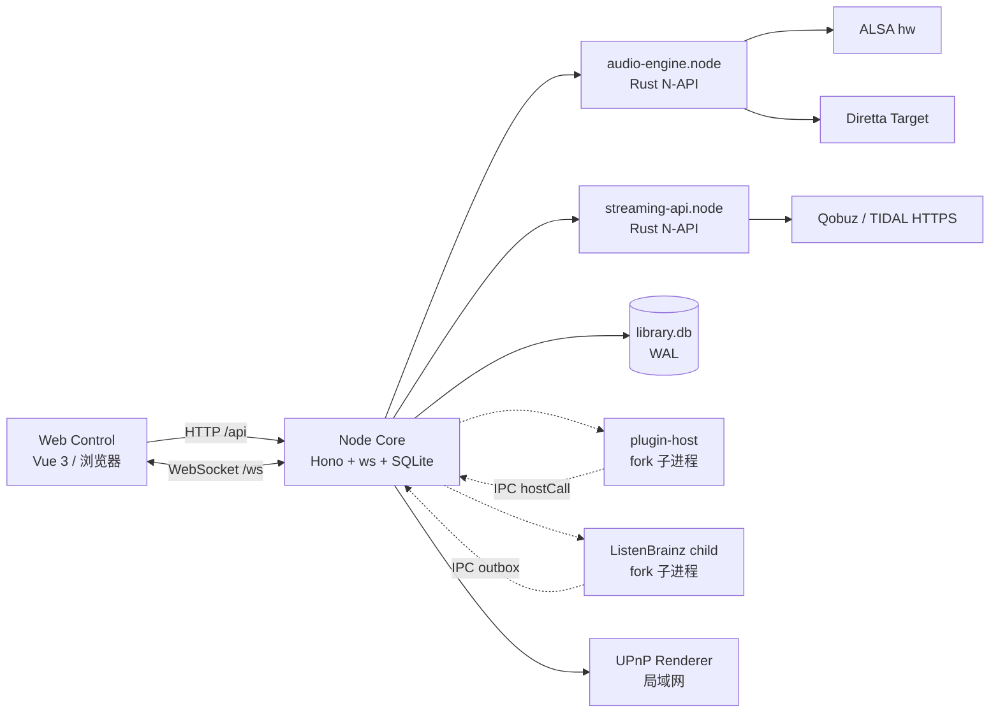

# SPlayer Atom 项目书

> 最后更新：2026-10-26
>
> 代码基线：`dev` 分支提交 `5693b3fc`，产品版本 `1.1.3`
>
> 文档性质：项目立项/现状说明，供项目负责人、架构评审与验收方阅读

## 1. 项目摘要

SPlayer Atom 是运行在 Linux x86-64 主机上的音乐播放器。它把音乐领域状态、播放控制、音源解析、缓存与持久化集中到一个常驻的 **Node Core** 进程，浏览器只承担 **Web Control** 界面。局域网内的电脑、平板与手机打开同一个地址即可控制播放；关闭网页不会中断 Core 中正在进行的播放，多台设备看到同一份队列、进度、登录状态与输出选择。

项目基于 [SPlayer-Next](https://github.com/SPlayer-Dev/SPlayer-Next) 修改，沿用其音乐数据模型与大部分界面能力，但把运行形态从桌面应用改造成“后台服务 + 浏览器控制”。音频链路下沉到 Rust 原生模块，支持 ALSA 的 Direct/Processed 两种路径、严格 Source Direct 的 Diretta，以及 Core 自有的 UPnP Renderer 输出。

当前版本定位为**可信局域网内的单用户、单活动输出**。它不是多租户服务，也不提供身份认证、TLS 或公网暴露能力。

## 2. 背景与问题

桌面音乐播放器通常把界面、播放引擎与媒体库绑在同一个进程甚至同一个窗口里：关掉窗口就停止播放，换设备就要重新登录、重新建队列，也无法把音乐主机放在机柜或听音室而用手机控制。

音乐服务器与 HiFi 主机场景有不同要求：

- 播放必须独立于任何一个浏览器会话，刷新、断网、切设备都不能中断。
- 多个控制端必须看到同一份权威状态，而不是各自维护一份队列。
- 输出路径必须可控：普通场景可以使用 EQ、响度、变速；严格场景必须保持采样值、位深、声道与 DSD 逻辑序列不变。
- 曲库、缓存、下载、插件与在线账号都在主机侧，升级与备份要有明确的数据边界。
- 发布物要能装在 Debian 11、GentooPlayer 等不同代际的 Linux 上，并能在无桌面环境的主机上长期运行。

SPlayer Atom 的答案是把“播放权威”从 UI 中剥离出来：Core 是唯一权威，Web 只是投影与命令入口；原生层只负责严格音频传输，不持有业务状态。

## 3. 产品定位与范围

### 3.1 一句话定位

面向 Linux x86-64 音乐主机、以浏览器为唯一界面的常驻音乐 Core。

### 3.2 使用范围

| 维度 | 当前范围 | 说明 |
| --- | --- | --- |
| 用户 | 可信局域网内的单个用户 | 无账号体系、无多租户隔离 |
| 控制端 | 任意数量的浏览器标签/设备 | 共享同一 Core 状态，无“控制权抢占” |
| 活动输出 | 同一时刻一个输出 | ALSA、Diretta、UPnP 三选一 |
| 平台 | Linux x86-64 | 原生模块在非 Linux 平台直接编译失败 |
| 网络 | 局域网 / 受保护的内网 | Core 无鉴权、无 TLS，不应直接暴露公网 |
| 媒体文件 | 用户自有，Atom 只读不删 | 删除只允许针对 Atom 自有缓存、临时与未完成下载 |

### 3.3 非目标

以下事项不在当前版本范围内，除非先有被接受的产品需求：

- 多用户、权限分级、家庭共享账号。
- 公网直连、内置 TLS、OAuth 登录 Core。
- Windows / macOS / ARM 正式产物。
- 移动端原生 App；移动端通过浏览器访问。
- 插件市场、插件签名与集中分发。
- 云端同步播放队列、跨 Core 迁移。
- 对音乐文件的删除、移动、重命名管理。
- 在严格 Diretta 路径上提供 EQ、音量、重采样、DoP、DSD 转 PCM 等处理。

## 4. 目标用户与典型场景

| 用户 | 场景 | 关键诉求 |
| --- | --- | --- |
| HiFi 玩家 | 音乐主机接 USB DAC 或 Diretta Target，手机/平板控制 | 位深/采样率原样输出、DSD 原生、无软件处理 |
| 家庭音乐服务器管理员 | NAS/小主机长期开机，家人用不同设备点播 | 常驻播放、多人共享状态、曲库集中 |
| GentooPlayer 用户 | 无 systemd 的定制音乐系统 | OpenRC 服务、低资源、可回滚升级 |
| 在线音乐用户 | 网易云/QQ/酷狗/Qobuz/TIDAL 与本地曲库混合使用 | 统一队列、统一搜索、统一歌词与下载 |
| 自建媒体服务器用户 | Navidrome/Jellyfin/Emby 等已有曲库 | 接入现有服务器，不重复导入 |
| 插件作者 | 用 JavaScript 扩展音源与控制能力 | 稳定 API、进程隔离、可更新 |

## 5. 目标与非目标

### 5.1 项目目标

1. **播放与界面解耦**：浏览器关闭、刷新、断线不影响 Core 播放。
2. **单一权威**：队列、索引、循环/随机、音源解析、重试/跳过、缓存、统计只在 Core 维护。
3. **多端一致**：所有 Control 通过快照 + 事件看到同一状态。
4. **输出可控**：普通输出可使用 DSP；严格输出必须显式拒绝不支持的格式，绝不静默回退。
5. **来源覆盖**：本地文件、CUE/SACD、自建媒体服务器、五个在线平台、插件音源。
6. **可长期运行**：服务化、崩溃重启、数据可迁移、缓存可淘汰。
7. **可交付**：system-runtime / bundled-runtime、Debian 11 兼容包、Diretta CPU 变体、源码包与发布身份。

### 5.2 成功判据

- 浏览器全部关闭后，Core 仍按队列继续播放，重新打开可恢复投影。
- 任一 Control 修改队列/输出/循环模式，其他 Control 在事件到达后一致。
- Diretta 路径对非无损整数 PCM、跨 wire-format 切换、DoP/DSD2PCM 明确报错，不产生“能播但被处理过”的结果。
- 升级保留 `data/` 后可恢复曲库、设置、歌单、统计、下载任务与登录状态；回滚不要求旧二进制读取新 schema。
- 发布产物可通过自动 smoke：native addon 加载、HTTP/WS、Web 根页、重启持久化、SIGTERM 退出。

## 6. 功能范围与完成度

状态口径：

- **已实现**：代码路径与自动测试存在，可在当前代码树中工作。
- **待验收**：代码已实现，但仍需要真实硬件、真实账号或目标浏览器的一次记录运行。
- **受限**：功能存在，但受输出格式、平台权益、网络或产品边界约束。

### 6.1 本地曲库

| 能力 | 状态 | 说明 |
| --- | --- | --- |
| 目录扫描与增量更新 | 已实现 | 单飞扫描、按 mtime/size 跳过、删除检测、进度事件 |
| 歌曲/专辑/歌手聚合 | 已实现 | SQLite 持久化，支持搜索、排序、随机 |
| 文件夹浏览 | 已实现 | 分页、固定目录、排序、筛选、递归搜索、批量操作、素材预览 |
| CUE 分轨 | 已实现 | 单 FILE CUE；75fps 精确边界；Direct 无缝路径 |
| SACD ISO 立体声分轨 | 已实现 | 虚拟分轨，原生 DSD 读取 |
| 标签读取/写入 | 已实现 | 只允许曲库已知文件；封面可来自本地或 URL |
| 点赞/本地歌单 | 已实现 | 本地红心、歌单 CRUD、旧数据导入 |
| 文件删除 | 不提供 | 产品约束：Atom 不删除用户音乐文件 |

### 6.2 播放

| 能力 | 状态 | 说明 |
| --- | --- | --- |
| 队列/索引/循环/随机 | 已实现 | Core 权威，持久化到 `playback_session` |
| 自动下一首/失败跳过 | 已实现 | 最多 `min(5, 队列长度)` 次；设备/未知错误不跳过 |
| 在线源过期重解析 | 已实现 | 非本地源最多一次 fresh resolve |
| 预载与无缝 | 已实现 | Direct 与 ALSA Processed 两条 gapless 路径 |
| 定时关闭 | 已实现 | 到点暂停，可等当前曲结束；仅内存 |
| 私人 FM | 已实现 | 依赖网易云登录；池不持久化 |
| 心动模式 | 已实现 | 以网易云歌曲/红心为种子生成队列 |
| A/B 循环 | 已实现 | 浏览器侧控制，Core 执行 seek |
| 变速/变调/EQ/响度/淡入淡出 | 已实现（仅 Processed） | Direct/UPnP 下锁定 |
| 跨重启恢复播放位置 | 不提供 | 队列/索引恢复，位置与自动关闭不恢复 |

### 6.3 音频输出

| 输出 | 状态 | 约束 |
| --- | --- | --- |
| ALSA Processed | 已实现 | 仅 mono/stereo；可 EQ/响度/变速；不做 ALSA resample |
| ALSA Direct | 已实现 | 保留有效位；整数不转 float；DSD 原生 |
| Diretta Source Direct | 已实现，硬件验收待完成 | 需 root、SDK 150、对应 CPU 变体；仅无损整数 PCM/原生 DSD；同 wire-format |
| UPnP Renderer | 已实现，硬件验收待完成 | 单 Renderer；无 gapless；1 秒轮询；CUE/SACD 需生成临时文件 |

### 6.4 在线与流媒体

| 能力 | 状态 | 说明 |
| --- | --- | --- |
| 网易云音乐 | 已实现，真实账号矩阵待验收 | 扫码/Cookie；官方 URL + 插件兜底；试听/权益错误分类 |
| QQ 音乐 | 已实现，真实账号矩阵待验收 | QQ/微信扫码、Cookie；原生 vkey + 插件兜底 |
| 酷狗音乐 | 已实现，真实账号矩阵待验收 | 扫码/Cookie；整曲失败退试听片段 |
| Qobuz | 已实现，真实账号矩阵待验收 | Rust 协议引擎；浏览器 OAuth 或 token |
| TIDAL | 已实现，真实账号矩阵待验收 | Rust 协议引擎；PKCE/设备码；刷新串行化 |
| Subsonic/Navidrome/OpenSubsonic/Airsonic/Gonic/LMS | 已实现 | 统一 Subsonic adapter |
| Jellyfin/Emby | 已实现 | 独立 adapter，会话缓存 |
| 评论 | 已实现 | 内置 NCM/QM/KG + 插件评论源 |

### 6.5 歌词、下载、缓存、插件、统计

| 能力 | 状态 | 说明 |
| --- | --- | --- |
| 歌词格式 | 已实现 | LRC/QRC/YRC/KRC/TTML/LyS/SRT/ASS |
| 歌词来源 | 已实现 | 本地内嵌/外挂、在线平台、插件、AMLL TTML |
| 歌词偏移 | 已实现 | 按曲目 + 歌词源持久化，`±60s` |
| 下载 | 已实现 | 串行、音质选择、标签/封面/歌词写入、重名策略 |
| 歌曲缓存 | 已实现 | 2 并发、LRU、大小上限、启动清理 |
| 图片/歌词缓存 | 已实现 | 可分类清理；封面缺失可重建 |
| 插件 | 已实现 | 独立 host 进程、vm 沙箱、Node permission、崩溃退避重启 |
| ListenBrainz | 已实现，真实 token 验收待完成 | 独立子进程 + outbox + 重试 |
| 播放统计 | 已实现 | 播放历史、收藏事件、热力图、Top 榜 |
| 多语言 | 已实现 | 简体中文 / English |
| 响应式布局 | 已实现，设备验收待完成 | 手机/平板/桌面三档 |
| PWA 离线 | 不提供 | 只有 manifest 元数据，无 Service Worker |

## 7. 系统架构

### 7.1 拓扑



### 7.2 组件职责

| 组件 | 职责 | 不负责 |
| --- | --- | --- |
| Web Control | 页面、交互、浏览器本地显示偏好、投影缓存 | 播放权威、重试策略、可播放 URL、Direct staging |
| Node Core | 音乐域状态、队列、持久化、凭据、音源解析、缓存/预载、下载、统计、插件与输出分配 | 实际采样传输与解码 |
| `audio-engine` | ALSA/Diretta 解码、DSP、Direct/Processed 输出、位置与边界事件 | 队列、业务重试、平台权益 |
| `streaming-api` | Qobuz/TIDAL 协议调用、token 刷新 | 业务缓存、播放策略 |
| `diretta-sys` | Diretta Host SDK FFI 与链接 | 格式协商策略 |
| plugin-host | 在 vm 中执行插件、代理网络/存储/控制调用 | 持有播放权威 |
| ListenBrainz child | SQLite outbox、HTTP 上报、退避重试 | 阻塞 Core 播放路径 |
| UPnP 媒体服务 | 向 Renderer 提供临时 HTTP 媒体 | 持久化用户文件 |

### 7.3 权威边界

| 状态 | 唯一权威 | 持久化 |
| --- | --- | --- |
| 队列、当前索引、repeat/shuffle | `playbackSession` | `playback_session` 单行表 |
| 当前曲目投影 | `nowPlaying` | 不持久化 |
| 输出选择、ALSA 模式 | Core settings | `settings.json` |
| 音源解析结果 | `playbackSourceResolver` | 不持久化（缓存字节持久化） |
| 预载/gapless stage | `playbackPreloader` | 仅内存 |
| 曲库 | SQLite `tracks` | `library.db` |
| 在线会话 | provider 模块 + 凭据文件 + `account_sessions` | `data/config/*`、`library.db` |
| 插件 | registry + manifest | `data/plugins/` |
| ListenBrainz | 父进程状态 + 子进程 outbox | `listenbrainz-outbox.db` |

### 7.4 一次播放的完整链路

```text
浏览器 POST /api/session/play-track 或 /api/session/queue/select
→ Core playbackSession 替换队列/选择索引
→ playbackSourceResolver 解析音源
   ├─ local：CUE 区间或文件路径
   ├─ cache：歌曲缓存命中
   ├─ streaming：自建服务器 adapter
   ├─ netease/qqmusic/kugou：Core 原生 URL → 插件兜底
   └─ qobuz/tidal：Rust streaming-api
→ UPnP？准备临时媒体 + Renderer 控制
   否？audio-engine 加载（Direct 或 Processed）
→ nowPlaying 更新 + session publish + trackLoaded 事件
→ 预载下一首（Direct staging / Processed staging / UPnP 媒体）
```

### 7.5 一次自然切歌

```text
audio-engine ended
→ Core 播放事件
→ advanceAfterNaturalEnd
   ├─ 自动关闭待停止？暂停并复位
   ├─ repeat one？重载当前
   └─ next() → 选择下一索引 → 加载
```

### 7.6 一次输出切换

```text
POST /api/output/select
→ 权限/设备检查（Diretta 需 root）
→ 记录当前曲目、位置、播放意图
→ 停止旧输出
→ 选择新输出并写偏好
→ 重新解析/物化当前源
→ 重载并恢复位置/播放意图
→ 失败则尽量回滚旧输出
```

## 8. 关键设计决策

### 8.1 单一 Core 权威

队列、索引、循环/随机、音源解析、失败重试、预载与统计全部在 Core。Web 只发高层命令并消费投影。这样多 Control 天然一致，浏览器断线不影响播放，也避免“两份队列互相覆盖”。

代价是 Core 的 `playbackSession` 成为热点：每次 publish 都序列化整队列写入 SQLite。当前通过“位置事件不 publish、仅队列/模式/切歌变更 publish”控制写放大；大队列高频编辑仍是已知性能风险。

### 8.2 严格 Diretta 是不可协商路径

Diretta 被定义为严格的 Source Direct：保持 PCM 采样值、有效位深、采样率、声道数；保持原生 DSD 的逻辑单比特序列、速率与声道数。允许无损解码与容器适配，但禁止重采样、混音、归一化、ReplayGain、EQ、非单位增益、淡入淡出、变速、变调、重编码、PCM 回退、DoP、DSD 转 PCM。

该约束落实在多层：构建 feature、root 权限、设备 selector、源格式检查、staged wire-format 一致性、DSD bit order 适配、实时回调无分配/无锁。任一不满足都显式失败，不做静默降级。

### 8.3 ALSA 双路径

- **Processed**：面向日常使用，允许 DSP；仅 mono/stereo；优先源采样率，硬件不支持时选择最接近的真实硬件 rate；关闭 ALSA resample；可启用 gapless。
- **Direct**：面向保真，保留有效位；整数绝不转 float；支持原生 DSD；拒绝不支持的源表示；CUE 用 75fps 精确边界。

两条路径共用同一 `audio-engine`，但运行期互斥，PCM 与 Native DSD 不能在同一 runtime 内直接切换。

### 8.4 UPnP 是 Core 自有输出

UPnP 不经过 native 输出，而是 Core 发现 Renderer、准备临时媒体、通过 SOAP 控制播放。它仍是唯一 playback session 的一部分，受同一套队列与输出选择管辖。限制是单 Renderer、无 gapless、1 秒轮询、CUE/SACD 需要离线生成临时文件。

### 8.5 插件进程隔离

所有启用插件共享一个 host 子进程，每个插件一个 `node:vm` context。host 以 Node `--permission` 启动，只允许读取 Core 构建目录，不能写文件、起子进程或加载原生模块。单插件异常只置自身 error；host 崩溃按 2s → 8s → 30s 退避重启，超过 3 次把相关插件置 error。

该模型的目标是**故障隔离与降低误伤**，不是强安全沙箱。插件安装 URL 本身仍是远程代码入口，只应安装可信来源。

### 8.6 ListenBrainz 独立子进程

启用后，SQLite outbox、HTTP 请求、重试与 token 校验全部在子进程；Core 只负责生成 captureId、维护阈值定时器与状态投影。禁用时不做任何后台工作。子进程崩溃 5 秒后重启，outbox 保留。

### 8.7 用户文件不可删除

Atom 不提供删除音乐文件的命令或 UI。所有清理只针对 Atom 自有的缓存、临时、暂存与未完成下载。扫描目录移除只删除数据库记录，不删除文件。下载任务删除只删任务行，不删已完成的音乐文件。

### 8.8 数据 schema 与协议版本

- 数据库 schema 当前 `8`，配置 schema 当前 `3`。
- Core Protocol 当前 `1`，Control 接受 `1..1`。
- 启动前检查 schema：数据库或配置版本高于当前构建支持值时拒绝启动，不尝试“猜测兼容”。
- 迁移前按需创建 `data/backups/migration-*`，SQLite 使用 `VACUUM INTO`。

## 9. 技术栈

| 层 | 技术 | 版本/说明 |
| --- | --- | --- |
| Web | Vue 3、Vue Router 5、Pinia 4、vue-i18n 11 | Vite 7、UnoCSS、Reka UI |
| Core | Node.js、TypeScript、Hono、ws、better-sqlite3、zod | Node `>=22.19.0`，打包参考 `24.18.0` |
| 原生 | Rust、N-API、ffmpeg_audio、ALSA、lofty | workspace 四个 crate；CI 固定 Rust 1.98.0 |
| 数据库 | SQLite WAL | `library.db`，schema 8 |
| 测试 | Node test runner、Vitest + happy-dom、cargo test | `pnpm test`、`pnpm test:native` |
| 构建 | pnpm、Vite、napi-rs、GNU tar | 可复现打包参数 |
| 文档 | VitePress | `pnpm docs:build` |

## 10. 数据与持久化

### 10.1 目录

| 路径 | 内容 | 是否权威 |
| --- | --- | --- |
| `<安装根>/data/` | 配置、数据库、插件、迁移备份 | 是 |
| `<安装根>/data/config/settings.json` | Core 设置 + `__configVersion` | 是 |
| `<安装根>/data/database/library.db` | 曲库、队列、统计、下载、歌词缓存、流媒体快照 | 是 |
| `<安装根>/data/database/listenbrainz-outbox.db` | ListenBrainz outbox | 是 |
| `<安装根>/data/plugins/` | 插件脚本、数据、manifest | 是 |
| `~/.cache/splayer-atom/` | 封面/歌手/背景/歌曲缓存、下载临时文件 | 可重建 |
| `~/Music/SPlayer Atom Core/` | 默认下载目录 | 用户媒体 |
| `/tmp/splayer-atom-*` | Direct/UPnP 临时物化文件 | 可清理 |

### 10.2 凭据

Qobuz、TIDAL、ListenBrainz、自建流媒体服务器的凭据文件写后 `0600`；`account_sessions` 表中的第三方 Cookie 以 JSON 明文存入 SQLite。`runtimeSecretCodec` 只是 `plain:<base64>` 编码，**不是加密**。因此：

- 整个 `data/` 目录应按 `0700` 保护。
- 备份等同于备份明文凭据，必须同等保护。
- 环境变量 `QOBUZ_*` / `TIDAL_*` 会覆盖 UI 登录结果，并可能出现在进程环境中。

### 10.3 缓存与淘汰

- 歌曲缓存：2 并发、按 key 去重、写入 `.part` 后 rename、成功后 LRU 淘汰到 `sizeLimitGb`（默认 10 GB）。
- 图片缓存：无自动上限，需手动清理；封面缺失时可按请求重建。
- 歌词缓存：三类表，TTL 策略不同；`lyric_cache` 无 TTL，需手动清理。
- 下载临时文件：启动时清理，未完成任务标记 `interrupted`。

## 11. 交付形态

| 形态 | 命令 | Node 来源 | 目标机要求 |
| --- | --- | --- | --- |
| system-runtime | `pnpm package:core` | 宿主机 Node | Node `>=22.19.0` |
| bundled-runtime | `pnpm package:core:bundled` | 包内 `runtime/bin/node` | 无需系统 Node |
| Debian 11 bundled | `pnpm package:core:debian11` | 包内 Node | glibc `>=2.30` |
| Diretta 变体 | `DIRETTA_SDK_ROOT=... pnpm package:core:diretta` 或构建脚本 | 视 `--bundle-node` | root + SDK 150 + CPU 变体匹配 |
| 源码包 | `pnpm package:source` | 不适用 | 需已发布提交与干净工作树 |

产物名包含版本、8 位提交、日期、时间、Diretta 变体与 runtime 形态。权威发布身份在包内 `runtime.json`，不在文件名。

## 12. 当前状态与里程碑

### 12.1 已进入代码树的能力

- Web + Core 迁移、ALSA HW Direct/Processed、Diretta Source Direct、UPnP 输出。
- Core 拥有的 Folder Browser、Direct CUE 无缝路径、响应式 Web 布局、歌词 P0/P1。
- 网易云、QQ 音乐、酷狗、Qobuz、TIDAL 的 Core/Web 路径。
- 插件系统、ListenBrainz、下载、缓存、统计、多语言。
- Debian 11 bundled 包（带/不带 Diretta）可构建；system/bundled 产物自动 smoke。

### 12.2 仍需记录验收的事项

以下来自路线图，属于“代码存在但缺少一次干净候选/真实环境记录”：

- 在干净候选产物上验证 ALSA 输出方案、格式与生命周期。
- 在发布候选上重做 UPnP 硬件检查与长时资源检查。
- 完成真实 Diretta CUE 无缝验收（相邻 PCM/DSD、seek、队列变更、长时运行）。
- 完成五个在线平台的完整真实账号矩阵验收。
- 完成 ListenBrainz 真实 token 的 Now Playing、永久收听、401/429、离线重试与重启验收。
- 完成代表性视口与真实移动设备的响应式验收。
- 完成多 Control 刷新/断线/重连的长时运行记录。
- 完成 Folder Browser 的 NAS/USB、超大目录、素材查看器更广验收。
- 在一个干净候选上执行安装、升级、回滚与最终硬件检查，然后发布。

> 项目书不把“代码路径存在”等同于“已验收”。发布决策应以路线图与验收记录为准。

## 13. 风险与限制

### 13.1 安全边界

| 风险 | 事实 | 缓解 |
| --- | --- | --- |
| Core 无鉴权 | 任何能访问端口的客户端都可控制播放、改设置、装插件 | 仅部署在可信 LAN；防火墙/VLAN；反向代理加认证 |
| 无 TLS | 凭据与操作明文传输 | 反向代理终止 TLS；不要公网直连 |
| Host/Origin 守卫非认证 | 只拦浏览器跨站与 DNS rebinding | 不替代身份认证 |
| 凭据弱保护 | base64 编码 + 0600 | 收紧 `data/` 权限；保护备份 |
| 插件可联网 | 安装 URL 是远程代码入口 | 只装可信插件；审阅脚本 |

### 13.2 运行限制

| 限制 | 影响 |
| --- | --- |
| 单活动输出 | 不能同时向两个 DAC/Renderer 播放 |
| 无跨重启播放位置 | 重启后队列恢复，但需重新 play |
| SIGTERM 非优雅关闭 | 只 flush 设置；UPnP 媒体、插件/LB 子进程、Direct 临时文件依赖 OS 回收与下次启动清理 |
| SQLite 同步 API | 大库查询/大队列写入会占用 Node event loop |
| 日志只有 stdout/stderr | 排障依赖 journald/OpenRC 日志；native 日志未初始化 |
| UPnP 无 gapless | 每首重新加载 URI，结束判定为轮询启发式 |
| ALSA 只列真实 hw | 无 default/plughw/softvol 回退 |
| Processed 仅 mono/stereo | 多声道被拒绝 |
| Native DSD 仅 Direct | Processed 下明确拒绝 |
| Direct 需本地 seekable | HTTP 源先完整物化，首播大文件有等待与磁盘占用 |
| 音乐文件不可删 | 产品约束，不是缺陷 |

### 13.3 已知接口缺陷

- `PATCH /api/session/queue/tracks` 被先注册的 `PATCH /api/session/queue/:index` 遮蔽，当前不可达；客户端应改用逐项更新或替换整个队列。
- `/api/capabilities.remoteOutput` 恒为 `false`，尽管 UPnP 已实现；服务端也不按 capability 拒绝路由。
- WebSocket 不推送 `position`；位置由客户端轮询 `/api/status` 获得。
- `/api/player/load` 是遗留低层接口，绕过 session 权威与音源解析，正常 Control 不应使用。
- `/api/player/read-lyric` 只校验扩展名，可读取 Core 进程可读的任意路径；`/api/filesystem/directories` 可列目录。这些是受信 LAN 模型下的已知暴露面。

### 13.4 交付风险

- CI 只构建 system-runtime，不构建 Debian/Diretta，不做 glibc 门禁；Debian 11 兼容包需用容器构建。
- Core 产物的 Vite target 是 `node24`，但运行下限声明为 `22.19`，未在 22.19 上做产物烟测。
- Core tar 无旁挂 checksum、无签名；只有源码包生成 `.sha256`。
- 迁移备份不会自动清理，长期运行需人工保留策略。

## 14. 许可证与合规

- 项目许可证：**GNU AGPL v3.0**。
- 上游：基于 SPlayer-Next 修改；再分发需遵守 AGPL 与上游版权声明。
- Diretta Host SDK 为专有组件，**不随产物分发**；构建时由 `DIRETTA_SDK_ROOT` 指向本机 SDK。发布的 Diretta 产物包含链接后的二进制，分发前需自行确认 SDK 许可。
- 第三方依赖清单见 `pnpm-lock.yaml`、`Cargo.lock`；发布时应随产物保留 `LICENSE` 与必要声明。

## 15. 术语表

| 术语 | 含义 |
| --- | --- |
| Core | 常驻 Node 进程，持有音乐域权威 |
| Control / Web Control | 浏览器中的 Vue 应用，只发命令与消费投影 |
| Source Direct | 不改变采样值/位深/声道/DSD 序列的输出路径 |
| Processed | 允许 DSP 的普通输出路径 |
| Direct PCM / Native DSD | ALSA/Diretta 的两种严格输出形态 |
| Gapless | 相邻曲目在同一输出 runtime 内无缝衔接 |
| stage / boundary | 预载在后台准备下一首；边界事件提交切歌 |
| CUE 75fps | CUE `INDEX 01 mm:ss:ff` 的 75 帧/秒整数坐标 |
| Personal FM | 网易云私人 FM，Core 维护内存池 |
| Auto-close | 定时关闭（暂停）播放 |
| Outbox | ListenBrainz 子进程的持久化上报队列 |
| capability | `/api/info` 声明的能力位，仅用于 UI 提示 |
| system-runtime | 依赖宿主机 Node 的产物 |
| bundled-runtime | 包内自带 Node 的产物 |

## 16. 相关文档

- [开发手册](./02-development.md)
- [运维手册](./03-operations.md)
- [使用手册](./04-user-guide.md)
- [程序接口文档](./05-api.md)
- [路线图](../atom-roadmap.md)
- [Core 部署与升级](../core-deployment.md)
- [构建与打包](../build-and-packaging.md)
- [硬件发布验收](../hardware-release-checklist.md)
